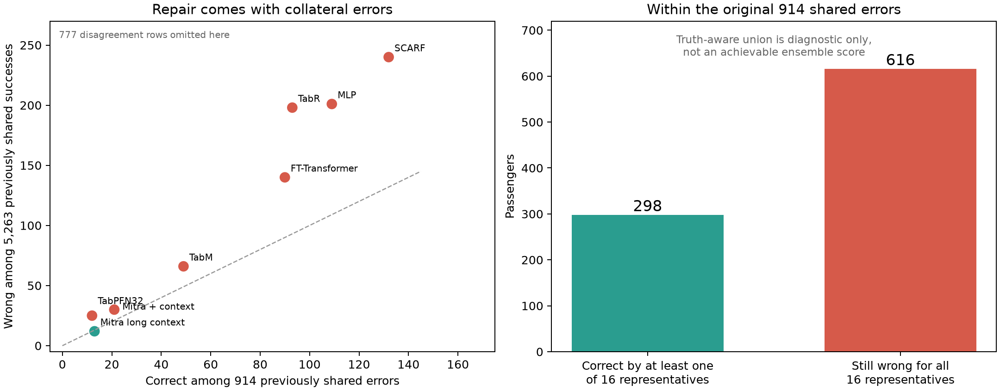

# 共同错例是什么，哪些方法能够修复

结论：历史模型确有互补能力，但现有替代模型修复困难样本时，通常会破坏更多原本正确的预测。共同错例集中在地球乘客；其中最鲜明的一类是休眠、零消费、G层，却没有被传送的人。现有字段还没有提供一个经验证能稳定区分这些例外的规则。不能把共同错误直接当成错标或不可预测的数据。

## 分析范围

沿用原6954条开发集的相同随机三折折外预测。原五个代表是v44树模型集成、v81适配Mitra、TabDPT、Kumo和EXAONE：共同正确5263条、共同错误914条、存在分类分歧777条。914条占v81的1266条错误的72.2%。这不是Kaggle隐藏测试集逐条错误分析；当前线上最佳v96没有完整三折OOF。

扩展复用24个历史配方、16个模型族代表的缓存，没有为目录重训模型。SCARF属于MLP族补充变体，不算新增独立模型族。旧缓存的身份核对依赖冻结源码、划分、完整控制预测一致和逐折指标重建；详见[目录](catalog.json)。

## 大家一起判错的人是什么样

下表只描述914条共同错例，不是训练或筛选规则。被传送指竞赛目标`Transported=True`。

| 共同错例人群 | 人数 | 实际未传送，全部预测传送 | 实际传送，全部预测未传送 |
|---|---:|---:|---:|
| 地球、休眠 | 300 | 296 | 4 |
| 地球、清醒 | 396 | 117 | 279 |
| 地球、休眠状态缺失 | 8 | 2 | 6 |
| 其他星球或星球缺失 | 210 | 75 | 135 |
| 总计 | 914 | 490 | 424 |

地球休眠乘客是最清晰的困难群体。全部开发集有1106位，其中300位被五个模型一起判错；这300位中283位在G层，265位五项消费明确全为零，其余35位有消费字段缺失。v81对所预测类别给出的概率中位数仅60.77%，五模型都给至少80%概率的只有1位。当前模型对这批错例多数概率接近分类边界，与“偏向更常见结果”的解释相容；不能证明现有特征本身没有区分能力，也不能证明这就是生成数据的真实机制。

在全部1106位地球休眠乘客中，722位实际被传送，384位未传送。v81正确识别了703位被传送者，但只识别出21位未传送者；准确率65.46%，仅略高于全部猜“被传送”的65.28%。这说明该配方在这个群体内几乎没有超过简单多数判断，特别难识别未传送的少数结果。不能看见错例中296位未传送，就把所有地球休眠乘客翻转为未传送；错误子集本身就是按结果筛出来的。

地球清醒的396条共同错例则以漏判实际传送者为主（279条）。其完整消费记录的总额中位数806，v81预测类别概率中位数73.11%，100条五模型都给错误类别至少80%概率。一个实际例子：地球、清醒、24岁、独行、F层，RoomService109、FoodCourt9、ShoppingMall25、Spa549、VRDeck44；五模型给传送概率12.64%–21.26%，真实标签为传送。它说明消费与结果的关系不是确定规则，不说明这条标签必然有误。

总体上，914条中只有182条是五模型都给错误类别至少80%的概率，达到95%的仅9条。模型一致不等于模型有把握；这些概率也未经证明是校准后的正确率。共同错例的年龄中位数24；375条五项消费明确全零，95条有消费缺失。缺失值不是全部困难的解释。

553条共同错例没有同组伙伴（60.5%），其余361条有伙伴，其中358条有已知同行休眠状态。同行信息有明确覆盖边界，不能指望仅靠新增同行属性解决多数共同错误。完整舱位和组号的训练/测试交集均为零，所以“拿同组训练乘客的已知标签直接推断测试乘客”没有实际测试覆盖；无标签同行属性仍然可用。

可复算证据：[错例画像](case_profile.json)、[全体人群分母与错误比例](structure_slices.csv)、[关系覆盖](structure_summary.json)。逐行标签和ID留在本地ignored artifacts，不提交到Git。

## 历史哪些模型能修复

| 方法 | 修复原914条共同错例 | 弄错原5263条共同正确样本 | 全6954条相对v81净多正确 |
|---|---:|---:|---:|
| SCARF自监督网络 | 132 | 240 | −139 |
| MLP | 109 | 201 | −121 |
| TabR检索网络 | 93 | 198 | −148 |
| FT-Transformer | 90 | 140 | −92 |
| TabM | 49 | 66 | −63 |
| v93更长支持上下文 | 13 | 12 | +22 |

中间两列只覆盖原共同错与共同正确集合，排除了777条分歧样本，不能直接相减当作总收益。v93总净增22条的分解是：共同错例+13、共同正确−12、分歧样本+21；改善主要仍来自分歧部分。

16个模型族代表中，只要任选一个模型判对就算修复，可覆盖914条中的298条，仍有616条全部判错。纳入同族变体的全部24配方可覆盖368条，仍有546条全部错。这是事后知道真实答案的“任选正确模型”统计，不是可部署路由器或可达到的准确率上限。剩余616条中473条来自地球、387条独行；196条是地球休眠者，其中195条实际未传送；272条是地球清醒者，其中214条实际传送。扩展模型族后，困难结构依然存在。

完整[逐模型修复与误伤](catalog_methods.csv)、[模型族归属](catalog_families.csv)、[扩展后剩余错误画像](remaining_error_profiles.json)。

## 本轮实际纠错实验

首先尝试固定的关系校正器：在原Mitra预测logit上，加入同行人数、同舱人数及与本人休眠状态的交互。复用已有严格内层OOF缓存，外层验证标签不参与拟合，也没有只在914条错误上训练。

结果：原Mitra81.65085%，关系校正81.66523%；修复31条、破坏30条，净增1条，逐折净增+3/−5/+3。原914条共同错中，原Mitra已能判对15条，关系校正判对18条，相对原Mitra是新增修复5、破坏2，不能把18都算新增修复。固定常数截距对照81.72275%，反而高于关系校正。该方法没有实质收益，不继续调正则或上传。见[结果](relational_result.json)、[事前协议](relational_protocol.json)。

另做一个固定验证折的三模型对照，直接比较原13列、增加两个人数特征、再增加两个同行休眠特征。三者从原始权重开始，同一训练4636行/验证2318行、seed和15次训练更新，训练采样完全一致。老缓存v81该折曾训练47步，单列历史参照，避免把步数差误当特征收益。结果单独保存在feature_probe_result.json；只此一个诊断折，不扩展CV、不当作独立测试或稳定领先证据。

## 后续判断标准

优先寻找能区分“地球休眠但未传送”和“清醒消费但被传送”的新增关系或上下文信息，并同时统计修复和误伤。现有更弱神经网络不能仅凭修复数量直接替换或混合。仅把已知错误加权、翻转某个人群，或用相同错误标签训练后再在这些错误上打分，都不能证明改进。分群混合、局部偏移和一致性补缺的此前小幅或负结果保留，不因找到相同困难人群就重新宣称路线有效。
