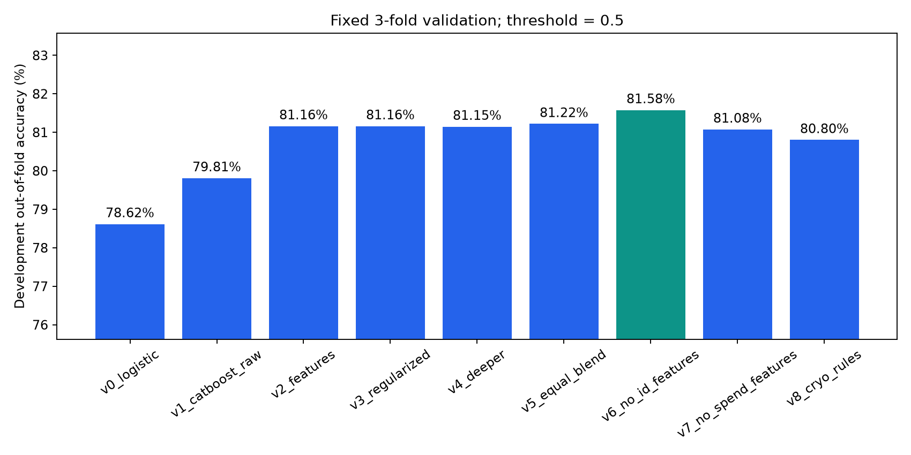

# Spaceship Titanic：run_002 实验结果

**以下均为本地实验结果，尚无 Kaggle 官方分数或排名。**

开发集 6954 人，留出集 1739 人；固定三折、阈值 0.5。

| 版本 | 开发集 OOF 准确率 | 折间标准差 | Log Loss | 训练耗时（秒） |
|---|---:|---:|---:|---:|
| v0_logistic | 78.6166% | 1.0510% | 0.44588 | 0.1 |
| v1_catboost_raw | 79.8102% | 0.4399% | 0.42963 | 5.3 |
| v2_features | 81.1619% | 0.7196% | 0.38553 | 5.8 |
| v3_regularized | 81.1619% | 0.3864% | 0.38566 | 7.7 |
| v4_deeper | 81.1475% | 0.4001% | 0.38467 | 11.0 |
| v5_equal_blend | 81.2194% | 0.3273% | 0.38374 | 复用三个模型预测 |
| v6_no_id_features | 81.5789% | 0.6720% | 0.38207 | 5.7 |
| v7_no_spend_features | 81.0756% | 0.1738% | 0.38862 | 5.6 |
| v8_cryo_rules | 80.8024% | 0.1614% | 0.38435 | 5.9 |

选定版本：**v6_no_id_features**；选择仅依据开发集，留出集没有参与选型。

- 一次性留出集准确率：**81.1961%**，Log Loss：0.37580。
- IID 近似下的 Wilson 95% 区间：79.29%–82.96%；同行相关性未计入，不是排名预测区间。
- 开发集群组隔离压力测试：**81.6077%**，三个折为 81.41%, 80.85%, 82.57%。
- 留出集混淆矩阵（行是真值、列是预测，顺序 False/True）：`[[693, 170], [157, 719]]`。

## 如何解释结果

- 比较版本时看同一开发集的 OOF 指标；留出集是另一批样本，不能用它与基线 CV 的差值宣称改进。
- 最优 CV 是多个候选中的胜者，可能有选择偏差；一次性留出评估用于独立核对。
- 树更深、模型融合不一定提升。保留没有获胜的版本作为实验材料。
- v6/v7 相对于 v2 分别移除编号特征和额外消费特征；原始五项消费金额仍保留。v8 测试休眠与消费逻辑的缺失填补。
- 原始数据来自已校验的公开镜像，与账号下载的官方数据直接比对仍待完成。
- 模型基于所有训练标签重训；提交文件通过列名、行数、ID 顺序和无缺失校验。

## 下一步

在 Kaggle 提交本目录的 `submission.csv`，记录真实线上成绩与排名。后续改进继续使用开发集验证，不能依据已打开的留出集反复调参。
